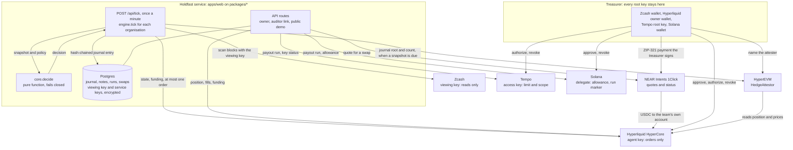

# Holdfast

Holdfast is a treasury autopilot for teams that are paid in ZEC and pay their costs in dollars: Zcash grantees, ecosystem organisations, grant treasuries. It does three jobs. It watches a shielded treasury with a viewing key. It fixes the treasury's dollar value with a short ZEC perpetual on the team's own Hyperliquid account. It pays contractors in stablecoins on Tempo and Solana. The service holds four keys over the team's accounts and none of them can move the team's money beyond a limit the chain itself enforces. Every movement of ZEC is a payment request the treasurer signs in their own wallet.

## Live

| What | Where |
|---|---|
| Landing page | https://holdfast-iota.vercel.app |
| Public demo workspace, read-only, no sign-in | https://holdfast-iota.vercel.app/demo |
| Application, sign-in with the wallet of the team's Hyperliquid account | https://holdfast-iota.vercel.app/app |
| The demo organisation as JSON | [overview](https://holdfast-iota.vercel.app/api/demo/demo/overview), [journal](https://holdfast-iota.vercel.app/api/demo/demo/journal), [keys and refusals](https://holdfast-iota.vercel.app/api/demo/demo/safety), [payouts](https://holdfast-iota.vercel.app/api/demo/demo/payouts), [receipts](https://holdfast-iota.vercel.app/api/demo/demo/receipts), [books](https://holdfast-iota.vercel.app/api/demo/demo/books) |
| Backtest scorecard as JSON | https://holdfast-iota.vercel.app/api/backtest/scorecard |
| Mainnet record, transaction by transaction | [docs/PROOF.md](docs/PROOF.md) |
| A five-minute path for a reviewer | [JUDGES.md](JUDGES.md) |
| Every claim with its evidence | [docs/CLAIMS.md](docs/CLAIMS.md) |
| What can go wrong | [docs/THREAT-MODEL.md](docs/THREAT-MODEL.md) |
| Source | https://github.com/RaYYeR220/holdfast |

The demo organisation is a real treasury of a few dollars on mainnet. A scheduled call ticks it once a minute, so its public journal grows by one entry a minute.

## The four keys

| Chain | Key the service holds | It can | It cannot | Who enforces that | The refusal on mainnet |
|---|---|---|---|---|---|
| Zcash | Unified full viewing key | Read payments in, their memos, the balance, and what the treasury itself sent | Spend, or sign anything | The Zcash protocol: a viewing key carries no authority to spend | None to show: the key has nothing to sign with. The read is in [PROOF 1](docs/PROOF.md#1-zcash-a-shielded-payment-read-with-a-viewing-key) |
| Hyperliquid | Agent key, approved once by the team's account | Place and cancel orders on the team's account, and switch its account mode | Withdraw or transfer the team's funds | Hyperliquid: a withdrawal or transfer acts on the account of whoever signed it, and the agent's own account is empty | A withdrawal and a transfer signed by the agent, both answered `Must deposit before performing actions`. This is the exchange's answer, not a transaction: [PROOF 3](docs/PROOF.md#3-hyperliquid-the-lock-and-the-agent-key-failing-to-withdraw) |
| Tempo | Access key with an expiry, a spending limit per period and a call scope | Call `transferWithMemo` on one stablecoin, to the recipients it lists when it lists any, up to the limit of the current period | Spend more, call any other function or token, pay after expiry or revocation | Tempo's Account Keychain, on every transaction the key signs | Two reverted transactions, `SpendingLimitExceeded` and `CallNotAllowed`, and a revocation: [PROOF 4](docs/PROOF.md#4-tempo-payroll-through-a-key-with-a-limit) |
| Solana | Token delegate on the team's USDC account, with a fixed allowance | Transfer up to the allowance out of that one token account | Exceed the allowance, move anything after the team revokes it, pay the same run twice | The SPL Token program for the allowance; the System program for the run marker | Two failed transactions, Token program errors `0x1` and `0x4`: [PROOF 5](docs/PROOF.md#5-solana-contractor-payouts-through-a-delegate-with-an-allowance). A run marker is set on mainnet; the chain failing a second payment is shown on devnet |

Fees are paid apart from the team's money. On Tempo a separate sponsor account, the service's own, pays the fee of every payout, so the access key's limit is spent on payouts alone. On Solana the delegate key itself pays the fee, the rent of a run marker and the rent of at most three new payee token accounts per run, out of SOL the service gives it; it holds no USDC.

The root keys stay with the treasurer: the Zcash spending key, the Hyperliquid owner wallet, the root of the Tempo account and the Solana wallet. Whatever needs one of them is prepared by Holdfast and signed in the treasurer's own wallet: a ZIP-321 payment request, an agent approval, a key authorization, a delegate approval, a revocation.

A fifth key moves no money. `HedgeAttestor` is a contract on HyperEVM, deployed at [`0xa6aFA5c68146BbD4C49510987847C7C38837824E`](https://hyperevmscan.io/address/0xa6afa5c68146bbd4c49510987847c7c38837824e). An attester named by the team's account records snapshots; for each one the contract reads the team's position and the prices from HyperCore itself and stores them beside the Merkle root of the controller's journal. The service makes an attester key for each organisation, and a deployment that is given the contract's address records a snapshot after a tick, no more often than every 60 minutes by default, once the team's account has named that key. The snapshots on mainnet, the second of them sent by the deployed service after a tick, are in [PROOF 7](docs/PROOF.md#7-hyperliquid-hyperevm-the-hedge-attested-on-chain).

## How a lock works and what it costs

A lock is a short ZEC perpetual on the team's own Hyperliquid account, sized to the ZEC the treasury holds in lots of 0.01 ZEC, so that a fall in the price of ZEC is offset by a gain on the short.

The short needs margin. The treasurer turns part of the treasury into USDC on that account through a NEAR Intents swap, paid from their own wallet. At the default policy the margin is 80% of the size of the short, which means selling about 44.6% of the treasury and hedging the 55.4% that is kept (`planLock` in `packages/core`).

The costs are the swap, the exchange's fee, slippage and funding. The backtest charges 0.5% on every swap and 0.045% on every order; the one mainnet order paid 0.005518 USDC on a fill of 12.26 USDC. Orders are immediate-or-cancel limits at most 0.30% away from the mark. Shorts receive funding when it is positive and pay it when it is negative; no new short is opened while funding over the last 72 hours is under -5% a year.

When ZEC rises the short loses and the margin ratio, account value over the size of the short, falls. Under 64% the service asks the treasurer for a top-up back to 80%. A top-up is again a payment the treasurer signs; the service cannot make it.

If the ratio falls under 20%, which from 80% takes a 50% rise in ZEC with no top-up, the controller buys back part of the short, down to what the remaining margin carries at 30%. This is the buy-back ladder. Lots bought back are not sold again until margin arrives.

The limit, stated plainly. A lock whose top-up requests are ignored through a strong rally loses its hedge to the ladder, and a crash after that hits a treasury that has already sold part of its ZEC for margin. In the control scenario below the locked treasury's worst point is -40.89%, against -7.64% for doing nothing. A lock also gives up the rise: over the whole recorded history the unlocked treasury ends at +435.64% and the locked one at +0.79%.

## Backtest scorecard

Nine scenarios replay the controller over hourly ZEC data from Hyperliquid, 16 March to 10 October 2026, 5,002 bars, bundled in `packages/core/data/zec-1h.json`. Each starts with a treasury of 100 ZEC.

| # | Scenario | Window | Top-up requests | Locked, worst point | Unlocked, worst point | Locked, end | Unlocked, end | Result |
|---|---|---|---|---|---|---|---|---|
| 1 | June 2026 crash | 1 to 15 June | never answered | -0.87% | -47.38% | -0.86% | -16.99% | pass |
| 2 | May squeeze, treasurer absent | 29 April to 13 May | never answered | -1.59% | -1.56% | +0.96% | +66.04% | pass: 3 buy-backs, cover falls to 22.08% |
| 3 | May squeeze, top-ups within 6 hours | 29 April to 13 May | answered after 6 hours: 2 top-ups, 10,650 USD | -0.54% | -1.56% | -0.33% | +66.04% | pass |
| 4 | Squeeze, then crash, treasurer absent | 29 April to 15 June | never answered | -40.89% | -7.64% | -18.04% | +45.70% | control: the lock does not hold, as written |
| 5 | Squeeze, then crash, top-ups within 24 hours | 29 April to 15 June | answered after 24 hours: 2 top-ups, 14,501 USD | -0.71% | -7.64% | -0.70% | +45.70% | pass |
| 6 | Venue unreachable through the worst hour | 1 to 10 June | never answered | -0.69% | -47.38% | -0.69% | -24.55% | pass: 48 decisions refused for lack of venue data |
| 7 | Lock requested on 20 June, while shorts are paying | 10 June to 20 July | never answered | -5.69% | -13.53% | +11.12% | +27.70% | pass |
| 8 | Largest one-hour spike | 6 to 9 April | never answered | -0.56% | 0.00% | -0.56% | +31.85% | pass |
| 9 | Whole history, top-ups within 24 hours | 16 March to 10 October | answered after 24 hours: 5 top-ups, 25,539 USD | -0.75% | -8.07% | +0.79% | +435.64% | pass |

"Worst point" is the furthest the treasury's dollar value fell below its value at the start of the window. "Unlocked" is the same 100 ZEC held with no lock; the tool prints it as "unhedged". The figures are the basis points of `holdfast backtest --json` written as percent. The text output rounds to one decimal.

How to read it:

- The windows and the pass criteria are in `packages/core/src/scenarios.ts` and were written before the first run.
- The first default policy had a 45% margin target. It failed four of the nine scenarios. The default became 80% and the criteria stayed.
- A thin-margin policy, 45% margin with a 3x leverage cap, is kept as a test fixture. `holdfast backtest --policy` fails it on four scenarios: 3, 5, 8 and 9. A test in `apps/cli` asserts exactly that.
- Scenario 4 is a control. It was written to show where the lock fails, so that a scorecard that cannot fail would be noticed. Its criteria are that the account is never liquidated and that the fall exceeds 15%. It is printed with the rest and does not count towards the verdict.
- The replay is pessimistic on purpose: inside each hour the price visits the open, both extremes and the close, liquidation is checked before the controller may react, and every order fills at its limit.
- It covers price paths. It says nothing about liquidity at size.

Run it yourself:

```
pnpm --filter @holdfast/cli holdfast backtest
pnpm --filter @holdfast/cli holdfast backtest --json
```

## Architecture



The tick. For each organisation `tick` in `packages/engine` takes a lease on the organisation, then reads three things side by side: the treasury (a scan of Zcash with the viewing key, re-reading the last 20 blocks each time, at most 5,000 blocks per tick), the venue (position, prices, account value, funding over 72 hours) and an independent reference price (the median of Coinbase, Kraken and the swap service's feed; at least two must answer, within 1% of each other). It calls `decide`, places at most one order with a client order id derived from the organisation and the entry number, and appends one journal entry whose digest covers its inputs, the decision and the entry before it. Where `HEDGE_ATTESTOR_ADDRESS` is set, an attestation step follows: if the chain shows the organisation's attester key as the attester of its account, the journal has grown and the latest snapshot is old enough, the service sends the journal's root and length and a salted commitment to the treasury balance. A failed attestation never changes what the tick did.

The controller. `decide` in `packages/core` is a pure function of a snapshot and a policy: no clock, no network, no randomness, and no AI anywhere in the decision path. It fails closed. A reading that is missing, older than 180 seconds or dated in the future counts as stale, and stale data never adds exposure. Buying back needs only fresh venue data. Selling needs every input fresh and every guard quiet: mark against oracle within 1%, oracle against the reference price within 1.5%, funding above the floor, leverage at most 2x.

Where each key lives. The viewing key and the service keys (agent key, access key, delegate key, attester key) are stored in Postgres, each encrypted with AES-256-GCM under `HOLDFAST_MASTER_KEY`. The Tempo fee sponsor's key is a setting of the deployment. Root keys are never asked for; pasting a spending key where a viewing key belongs is refused by its shape.

What is read from the chain at request time. The remaining limit and scope of the Tempo key come from the Account Keychain, the Solana allowance from the token account, the position and funding from Hyperliquid, a payout run from the chain it was paid on, a snapshot from the contract on HyperEVM. None of these is answered from the database. The treasury balance is the exception: it comes from the latest tick, the only thing that reads Zcash with the viewing key, and is reported as unavailable once it is older than the policy allows.

## Repository map

Test counts are tests passed by `pnpm test` on 12 October 2026.

| Path | What it is | Tests |
|---|---|---|
| `packages/core` | Policy, `decide`, top-up and sweep advice, lock planning, journal digests and Merkle root, the backtest and its scenarios. No I/O | 115 |
| `packages/engine` | The tick: read, decide, place one order, write the journal. The `Store` contract and an in-memory store | 23 |
| `packages/zcash` | Scanner over lightwalletd with a viewing key, viewing-key check, ZIP-321 payment requests | 37 |
| `packages/hyperliquid` | Account state, funding, immediate-or-cancel orders that are safe to retry, the agent approval, the withdrawal probe | 141, and 4 that read mainnet when `HL_LIVE=1` |
| `packages/intents` | NEAR Intents 1Click quotes and status; the reference price | 24 |
| `packages/tempo` | Access-key authorization, the payout rail, lookup of a run by its memos, the two refusal probes | 191, and 1 for Moderato when `TEMPO_MODERATO=1` |
| `packages/solana` | Delegate approval and revocation, the payout rail with its run marker, lookup of a run, the refusal probes | 286, and 1 for devnet when `SOLANA_DEVNET=1` |
| `packages/db` | Postgres schema and migrations, the store with its lease, encryption of stored keys | 199 on an in-process Postgres, and 36 for a real one when `HOLDFAST_TEST_DATABASE_URL` is set |
| `packages/books` | One ledger across all sources, statements, reconciliation, auditor scopes, the published statement | 310 |
| `packages/attest` | ABI of `HedgeAttestor`, journal leaves and proofs, the treasury commitment, reads of the contract | 47 |
| `apps/web` | Next.js: the API, `/api/tick` with its attestation step, the pages and their client code | 352 |
| `apps/cli` | `holdfast backtest` and `holdfast verify` | 98 |
| `contracts` | `HedgeAttestor.sol` with Foundry tests | 67, and 6 read-only fork tests against HyperEVM mainnet when `HYPEREVM_FORK_URL` is set |

## Quick start

Prerequisites: Node 24 or later and pnpm 9.15. Foundry 1.8 for the contract tests. Postgres for the web application; 17 is what it was run on. Docker is optional.

```
pnpm install
pnpm test                                        # every package
pnpm --filter @holdfast/cli holdfast backtest    # the scorecard
cd contracts && forge test                       # the contract
```

Run the web application locally:

```
cp apps/web/.env.example apps/web/.env.local     # then fill it in
DATABASE_URL=postgres://... pnpm --filter @holdfast/db exec tsx scripts/migrate.ts
pnpm --filter @holdfast/web dev
```

The required settings are `DATABASE_URL`, `HOLDFAST_MASTER_KEY`, `TICK_SECRET`, `SESSION_SECRET`, `HOLDFAST_PUBLIC_HOST` (in production), `HOLDFAST_NETWORK` and `TEMPO_SPONSOR_PRIVATE_KEY`. Each is explained in [`apps/web/.env.example`](apps/web/.env.example), with the optional ones: RPC endpoints, the payout tokens, `SOLANA_MARKERS_FROM`, and `HEDGE_ATTESTOR_ADDRESS`, which switches attestations on. A setting is read the first time something needs it, and a missing one fails that request with a message naming the variable.

Nothing ticks by itself. A scheduler has to call the tick endpoint:

```
curl -X POST -H "Authorization: Bearer $TICK_SECRET" http://localhost:3000/api/tick
```

## Verify the books yourself

Three checks, from the quickest to the fullest.

Read the shielded payment with the published key. The viewing key of the demo treasury is in [`demo/treasury.ufvk`](demo/treasury.ufvk). Save this as `scan.mts` in the repository root and run `pnpm exec tsx scan.mts`:

```ts
import { readFileSync } from 'node:fs';
import { MAINNET_ENDPOINTS, createTreasuryScanner } from './packages/zcash/src/index.ts';

const ufvk = readFileSync('demo/treasury.ufvk', 'utf8').trim();
const scanner = createTreasuryScanner({ network: 'mainnet', endpoints: MAINNET_ENDPOINTS });
const scan = await scanner.scan({ ufvk, fromHeight: 3_512_987, toHeight: await scanner.tip(), knownNullifiers: [] });
for (const note of scan.notes) console.log(note.height, note.kind, note.zat, 'zat', note.spent ? 'spent' : 'unspent', note.txid, note.memo);
for (const out of scan.outgoing) console.log(out.height, 'sent', out.zat, 'zat', out.pool, out.txid);
```

It prints the payment of 1,975,000 zatoshi at block 3,513,140 with its memo, the change of 1,030,000 zatoshi and the 930,000 zatoshi sent to the swap. An explorer shows that the first transaction exists and neither its amount nor its memo. Any wallet that imports a viewing key shows the same as this script.

Hold the journal against the chain. The command in [PROOF 7](docs/PROOF.md#7-hyperliquid-hyperevm-the-hedge-attested-on-chain) asks `HedgeAttestor` whether journal entry 2 is under the root it stored, and `attestationFor` in `packages/attest` gives that root from the first ten entries of the public journal.

Derive a statement again. `holdfast verify` takes a statement export and repeats the work instead of trusting it:

```
pnpm --filter @holdfast/cli holdfast verify "$PWD/demo/statement.json" --ufvk-file "$PWD/demo/treasury.ufvk"
```

Relative paths are read from `apps/cli`, so give absolute ones. [`demo/statement.json`](demo/statement.json) is the demo organisation's export as of 12 October 2026, 18:06 UTC: 130 journal entries, one fill and 46 funding payments on Hyperliquid, the swap and the two payout runs. An export is the file the owner of an organisation downloads from `GET /api/orgs/<id>/books/export`; `apps/web/scripts/export-statement.ts` writes the same file from the command line. On that file the tool answers `VERIFIED: all 5 steps passed`.

The tool runs five steps: the journal chain, Zcash (a scan with the viewing key), Hyperliquid (the account's fills and funding), reconciliation, and arithmetic. It exits 0 only when every step ran and passed. With `--offline` or without a key the two chain steps are not run and the verdict is `NOT VERIFIED`. It verifies mainnet statements only.

It prints beside each step what a pass still rests on. In its own words, with the address and the counts left as placeholders:

- journal: "the chain shows the journal was not altered after it was written; nothing here shows it is the only journal ever written"
- zcash: "the key is the key of [address]; that this is the address the organisation is paid at is for the reader to know"
- zcash, when the ledger books payments as swap deposits: "the chain shows the payments, not what they paid for"
- hyperliquid: "the account value the journal recorded at each moment is not something the venue can be asked for afterwards"
- reconciliation: "the [n] payout run(s) are held against the transfers the statement itself lists; Tempo and Solana were not read"
- reconciliation: "the [n] swap(s) are held against the statement's own swap records; the swap service was not asked"
- arithmetic: "the dollar price applied to each ZEC entry is the ledger's own; no price source was consulted"

The first of these is what the root on HyperEVM is for. A stored root stays readable, and a journal rewritten afterwards no longer matches it. `holdfast verify` does not make that comparison itself.

## Self-hosting

`docker compose up --build -d` starts Postgres, a one-shot migration, the web application and a scheduler that calls the tick endpoint every minute. The steps, the settings and the manual path without Docker are in [docs/SELF-HOSTING.md](docs/SELF-HOSTING.md).

## Privacy

What stays private: the payments made to the treasury's shielded address, their amounts and memos, and its balance. Only the holder of the viewing key reads them. An attestation commits to the balance with a salted hash and does not show it.

What is public:

- The hedge. The Hyperliquid account, its position, fills and funding are readable by anyone who knows the account's address. At a hedge ratio of 100% the size of the short is the size of the ZEC the treasury holds.
- Every payment into a swap. The swap service takes transparent ZEC only, so the amount and the deposit address are public.
- The payouts on Tempo and Solana, with their amounts, recipients and memos.
- Each snapshot on HyperEVM: the position, the prices, the journal root and the number of entries.

Two further limits. The service reads everything the viewing key shows, so whoever operates the server sees the treasury; self-hosting is the answer to that. And the demo treasury's viewing key is published on purpose, so the demo treasury is not private.

## What this is not

- No users besides the demo organisation, which is our own. No revenue, no audit, no token.
- The amounts in the demo are a few dollars. Nothing here says how the system behaves with size.
- Not a custodian. The service holds no funds. Its two paying keys pay out up to limits the team sets, and no key it holds can do more. It also cannot top up margin, which is why an ignored lock can fail: see scenario 4.

Not built yet:

- No second payment of a Solana run has been sent on mainnet. Run `HF-2026-10-0004` set its marker there; the chain failing a repeat is shown on devnet.
- `holdfast verify` does not read Tempo, Solana or the swap service, and does not compare the journal with the root on HyperEVM.
- Swaps deliver to the team's Hyperliquid account and Solana wallet. Funding the Tempo account from ZEC inside the application is not built.

## Licence

MIT. See [LICENSE](LICENSE).
